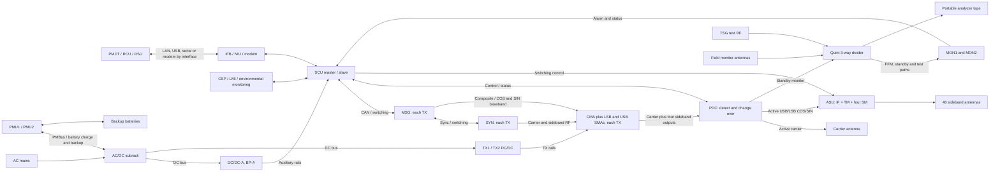

# DVOR 220 — đối chiếu simulator với tài liệu

Phạm vi: sơ đồ khối, mặt thiết bị và PMDT. Đây là báo cáo baseline, không phải
hướng dẫn bảo trì thiết bị thật. Đối chiếu mã nguồn tại [`c2ee5b8`](https://github.com/nhhaituhpy-hue/cns-simulation/commit/c2ee5b8);
không đánh giá LMI như một ứng dụng riêng, DME 320, hoặc chức năng AI.

## Nguồn và quy ước

| Ký hiệu | Tài liệu | Dùng để đối chiếu |
| --- | --- | --- |
| TM | [220 DVOR Tech Manual 20240320](https://drive.google.com/file/d/1kawZqtKQuJqGpVqxFqMXQT5q7_vpw7mQ/view) | 560 trang PDF; các trang chương được viện dẫn mang Rev. 0/2022-01-28. Ch. 1/3: hệ thống; ch. 4: PMDT/CSP; ch. 6/7/9: điểm đo và hiệu chỉnh. |
| CR | [Sử dụng PMDT DVOR 220 Cam Ranh](https://drive.google.com/file/d/1po4pTePLULoFY2DmQ77XXbD0XHPd-QWT/view) | 15 trang PDF; nguồn cho menu, nhãn và bố cục của bản PMDT tại Cam Ranh. |
| HC | [Tài liệu hiệu chỉnh DVOR 220](https://docs.google.com/document/d/1at5AD7GveWcdQkCeXTQFqqY3WQmCEssu/edit) | 30 trang bản xuất PDF; nguồn cho luồng Calibrate / Save / Close và Helper. |

Số trang dạng `7-26` là số in trong TM; số trang PDF là vị trí đếm từ trang bìa.
Đọc các cột dọc từ trên xuống và hàng ngang từ trái qua phải, ở hướng nhìn
của hình. Hình tham chiếu quyết định vị trí tương đối; tài liệu không cho kích
thước cơ khí của từng tâm điểm. Tọa độ phần trăm dưới đây chỉ là tâm đọc từ
hình (không phải kích thước chế tạo). Không biến đầu nối nội bộ thành điểm đo
mặt trước hoặc biến một nhãn chưa đọc được thành tên đo suy đoán.

## 1. Sơ đồ chức năng

Nguồn chính: TM Fig. 1-8 (PDF 32), Table 1-1 (PDF 39), Figs. 1-14 / 1-18 /
1-19 / 1-20 (PDF 42 / 46 / 47 / 48); Fig. 3-15 cho phân phối tín hiệu đo;
Figs. 3-58, 3-70, 3-71 cho PDC / ASU. Các đường dưới đây là đường chức năng,
không phải danh sách chân giắc hoặc tuyến dây.

**Khoang thiết bị.** 1A1: CSP, TSG, SCU ×2, EMU, NIU ×2, DC/DC-A ×2,
MODEM ×2, VAU, BP-A. 1A2/1A3: LSB SMA, CMA, USB SMA, DC/DC, MSG, SYN, MON,
FAN và hai backplane; 1A4: bộ cầu dao và PMU ×2; 1A5: AC/DC; 1A6: LMI trên
cửa; 1A7: IFB; 1A8: PDC; 1PD1: bộ chia; 2A1: ASU ngoài tủ gồm IF, TM,
bốn SM (COS LO/HI, SIN LO/HI) và tùy chọn power monitor. Đối chiếu TM
Figs. 1-12, 3-1–3-7; danh sách §3.1.2 và Table 1-1 đáng tin hơn nhãn
slot lệch trong hình 3-2 (ví dụ VAU là 1A1A12).

**Baseline.** [Sơ đồ hiện tại](../../src/modules/operations/dvor-220/dvor220-system-diagram.tsx)
đã có năm hình giản lược, cặp TX, PDC, ASU, bộ chia và hai MON. Nó chưa phải
sơ đồ dây của TM: overview gộp bus nguồn và chỉ nối DC/DC-A tới SCU, gộp
đường đo MON và không vẽ nhánh đầu đo PIR của bộ chia. Khối AC/DC `×3`
khớp cấu hình chuẩn trong Fig. 1-8 / Fig. 7-25: khay có năm vị trí, ba bộ ở
A1/A3/A5. CR 5 cũng hiển thị AC/DC-A/C/E; giữ tách biệt ký hiệu vị trí
với số lượng thiết bị được lắp.

## 2. Mặt thiết bị: vị trí và sai khác

Code đối chiếu: [mặt chi tiết](../../src/modules/operations/dvor-220/dvor220-module-faceplates.tsx),
[tủ](../../src/modules/operations/dvor-220/dvor220-cabinet.tsx) và
[dữ liệu phép đo](../../src/modules/operations/dvor-220/block-diagram-data.ts).
Phân biệt **hiện diện**, **đúng vị trí** và **có thao tác/mô hình**:
nút/đèn minh họa trong SVG không đồng nghĩa có hành vi thiết bị.

| Khối / hình TM | Mặt chuẩn để vẽ | Sai khác hiện tại |
| --- | --- | --- |
| **LMI**, Fig. 4-1 / Tables 4-1–2 (PDF 188–190) | Màn hình rộng bên trái; cột phải NORMAL, WARNING, ALARM, MAINT; khóa LOCAL–REM–MAINT ngay dưới cột. Các đầu nối của embedded PC nằm ở mặt sau, Fig. 3-10. | Đúng thứ tự lớn, nhưng thêm title/brand và LED giả trong từng ô; mặt chi tiết không điều khiển khóa. |
| **CSP**, Fig. 4-2 / Tables 4-3–6 (PDF 191–193) | Trên: hai cột TX giống gương, MAIN / ON ANT / FAULT / POWER / ENABLE; LOAD ngoài hàng ON ANT, cặp SMA–CMA ở hàng ENABLE. Giữa: nhóm Monitor 1 EXEC/STBY và 2 STBY/EXEC, NORMAL/WARNING/ALARM rồi BYPASS. Dưới trái: CHANGEOVER, ANT FAULT, AC MAIN, ON BAT, ENVIRONMENT, TxD, RxD; dưới phải: RESET, LAMP TEST, SILENCE, VOLUME. | Thiếu số 1/2 ở nhóm MON, TxD/RxD; VOLUME nằm gần giữa thay vì dưới SILENCE bên phải; BYPASS in lặp dưới hai nút thay vì ở giữa. Đèn tích hợp và phím SVG không phản ánh hành vi điều khiển. |
| **TSG**, Fig. 7-1 (PDF 465) | Một cột: POWER xanh, FAULT đỏ, PLL FAULT đỏ, MCU 14 chân, RESET, CPLD 10 chân, BNC VOR RF SIGNAL. Tâm cao độ trên hình: khoảng 19/24/29/44/53/67/77%. | Thứ tự chính đúng; dùng thẻ chung với nhãn CPLD/SERVICE; tỷ lệ khoảng cách, ejector và trục dọc không theo hình. |
| **SCU**, Fig. 7-2 (PDF 466) | Một cột: POWER xanh, FAULT đỏ, MASTER/SLAVE xanh, CAN TxD TTL, CAN RxD TTL, MCU 14 chân, RESET, CPLD 10 chân. Hai CAN là **test pin**, trên MCU, ngay sau ba LED. Tâm cao độ giữa hai đầu ejector: khoảng 19/24/29/33/36/44/53/67%. | Hai CAN đang vẽ là jack ở gần đáy, sau CPLD. MASTER cố định thay vì thể hiện master/slave. |
| **DC/DC-A**, Fig. 7-3 (PDF 468) | Giữa thân hẹp, không có tay kéo dài bên hông: POWER xanh, INPUT FAULT đỏ, OUTPUT VOLTAGE FAULT (xanh theo callout), +5, +15, −15, GND. Ba jack đỏ, GND đen; liền sau cụm LED, ở khoảng 52–66% chiều cao. | Có đủ jack theo thứ tự nhưng giãn cả cột, thêm tay kéo kiểu TX và chuyển cụm LED về sát đỉnh. |
| **SMA USB và LSB**, Fig. 7-4 (PDF 470) | Tay kéo dọc trái; cột phải POWER, COS/SIN RF ON, COS/SIN FAULT. Hai BNC ENV dưới cụm LED một khoảng lớn: COS J5 trên SIN J6. Tâm theo chiều cao cả tai: LED khoảng 20/25/29/34/38%, ENV 74/82%. | Có đúng hai điểm đo và nhóm đèn; dùng nhãn RF ON/FAULT lặp, thân và khoảng cách ENV không theo hình, nhất là COS bị đẩy lên. |
| **CMA**, Fig. 7-7 (PDF 473) | Tay kéo bên trái; POWER, RF ON, FAULT trên cột phải; J2 ENV gần đáy cột, thấp hơn rõ rệt so với các LED. Tâm cao độ khoảng 20/25/29% và 82%. | Có J2 đúng loại, nhưng ở 72% viewBox và bố cục dùng khung chung thay cho tai và mặt hẹp. |
| **DC/DC TX**, Fig. 7-10 (PDF 476) | Tay kéo trái; bên phải POWER, INPUT FAULT, OUTPUT VOLTAGE FAULT; +5, +8, +15, −15, +28, +50, GND cùng một trục. Các jack ở khoảng 39/46/52/58/64/70/78% chiều cao. | Đúng bộ jack và thứ tự; các trục, tai gắn và khoảng cách không khớp hình. Không lấy danh sách rail trên PMDT làm nhãn jack. |
| **MSG**, Fig. 7-11 (PDF 477) | POWER/FAULT, MCU 14 chân, CPLD 10 chân, RESET, 30 Hz SYNC BNC, TP49 carrier, rồi TP61/62/63/64 USB COS / LSB COS / USB SIN / LSB SIN. TP49 ~67%; cụm cuối ~75/78/81/84%; có thêm chân không gắn nhãn trong hình, không tự gán chức năng. | Các mục đã gọi tên đều có; cần đặt lại một trục, khoảng cách không đều và phần ejector. Không gộp minh họa bo thật với các chân có phép đo. |
| **SYN**, Fig. 7-16 / §7.2.16 (PDF 480–481) | J1 CSB MON ở ~19%, LED6 POWER / LED7 PLL / LED8 ERROR ở ~29/32/34%; khối header sau LED; dãy SW2–SW6 dọc phía dưới header, bốn test pin TP33–TP36 thấp hơn, J6 40 MHz MON ở ~81%. Hình còn có chi tiết không chú thích; không tự gán tên. | J1/J6 và bốn TP có; SW2–SW6 lại nằm **ngang**. Nút RESET / nhãn SERVICE của hình hiện tại cần đối chiếu thêm trước khi gắn tên hoặc thao tác. |
| **MON**, Fig. 7-17 (PDF 482) | POWER, FAULT, INTEGRAL ALARM, INTEGRAL WARNING, SECONDARY ALARM, STANDBY ALARM, STANDBY WARNING, SECONDARY ALARM, IDENTITY CODE, rồi MCU 14 chân, Zynq 10 chân, RESET và TP47/48/49/51 (Ident, FM 30, baseband, AM 30). Hình in SECONDARY ALARM hai lần: giữ đúng vị trí, không tự diễn giải là hai kênh khác nhau. | SECONDARY ALARM thứ hai đặt sai trước STANDBY; tất cả LED và cụm TP giãn quá đều. Các đèn chưa bám trạng thái riêng từng MON/TX. |
| **FAN**, Fig. 7-22 (PDF 485) | Dầm ngang mỏng; cụm **ngang** sát đầu phải, POWER xanh rồi FAN 1–4 FAULT đỏ, cuối cùng Molex 6 chân nguồn/điều khiển. | Đèn đang thành một cột và hình chi tiết dùng dãy quạt nhìn thẳng thay cho mặt mỏng trong hình kiểm tra. |
| **PDC**, Fig. 7-23 (PDF 486), Fig. 6-1 (PDF 434), Fig. 9-8 (PDF 548) | Hàng dưới: J20 LSB COS, J21 LSB SIN, J22 USB COS, J23 USB SIN, J24 CARRIER. Tâm khoảng 9/30/57/79/91% bề rộng của riêng tấm connector. Tay kéo **ngang** dưới cặp giữa; captive screw ở hai bên phía dưới. LED1 xanh ở PDC-IF **bên trong**. 1A8A1A1VR1 là chi tiết nội bộ, không nằm trên mặt năm cổng. | Có năm cổng đúng thứ tự nhưng bố trí đều; tay kéo dọc, LED1 được đưa ra mặt trước. VR1 hiện chỉ là tham chiếu đọc, chưa có hình vị trí nội bộ. |
| **Cầu dao 1A4**, Fig. 3-4 / 7-24 (PDF 98/487) | AC AVAILABLE ở phần trên trái, dòng nhãn bên phải đèn. Bên dưới: AC MAIN (cặp liên động), BATT 1, BATT 2, trên một hàng. | AC MAIN đang cùng hàng với đèn, ba cầu dao có hình tương tự nhau và không thao tác được từ SVG. |
| **PMU**, Fig. 7-24 (PDF 487) | Tay kéo ngang trên cùng. Dưới: MCU 14 chân trái, GND / BAT V / AC/DC V / RESET trên **cùng một hàng** về bên phải. Khối dưới có FND bên trái, bên phải lần lượt AC FAIL đỏ / ON BAT hổ phách / BAT CHARGE hổ phách, và hàng phím PMU TEMP / AC/DC V / AC/DC I / BAT V / BAT I bên dưới. | Jack và đèn vẽ dọc; RESET tách hàng; đảo V/I của cả AC/DC và BAT; FND cố định `----`, các phím không đổi số đo. |
| **AC/DC**, Fig. 7-25 (PDF 488) | Tay kéo trích ở mép trên; grille chiếm phần lớn mặt; dưới giữa là núm nhả, đèn AC OK/Fail rồi DC OK/Fail về phía phải núm. Mỗi đèn hai màu xanh/đỏ. | Cả hai đèn dọc ở trái, núm ở phải, không có tay kéo ở trên; không có trạng thái lỗi hai màu. |
| **ASU / ASU có PM**, Figs. 3-68–3-76 (PDF 164–172) | Cửa ngoài đóng không có lưới cổng. Nhìn trong: ASU-IF trên trái, TM trên phải, bốn SM ở giữa thành 2×2; mỗi SM **một vào, 12 ra**. Bản có PM có đồng hồ và selector ở dưới trái, các phần tử đo/coupler và ngõ RF dọc phần đáy. Phân biệt bản P/N 0233-7210 và 0233-7211. | SVG trộn vỏ với nội thất, mỗi SM chỉ 6 chấm ngõ ra và dãy năm núm không khớp ảnh; các cụm ASU không có mặt chi tiết riêng ngoài mặt chung kiểu card cho ASU-IF. |
| **Quint 3-way divider**, Figs. 3-14/15 (PDF 107) | Năm BNC female 50 Ω cho máy đo PIR trên một hàng ở mặt rộng; năm nhánh FFM1/2/3, standby, TSG. Các cặp phân phối MON và đầu vào ở các cạnh, không phải jack PIR. Fig. 3-15 định danh chức năng; không dùng thứ tự schematic để gán nhãn mặt chụp không in tên. | Có khối nhưng không có mặt chi tiết gắn năm jack đo. Nên kiểm tra ảnh có nhãn trước khi gán tên theo chiều trái–phải. |
| **IFB / EMU**, Figs. 3-16/17, 3-24/25 (PDF 108–109, 118–119) | IFB là bo giao tiếp: bốn D-sub ở cạnh trên trong ảnh; nhóm LAN/USB và terminal ở cạnh dưới, header hai bên. EMU là card cảm biến/I/O, hình khay 3-2 và ảnh 3-24 xác định chi tiết nhìn thấy, sơ đồ 3-25 tách JP1/JP2 nội bộ với I/O. | IFB chưa có mặt chi tiết; EMU dùng khuôn POWER/FAULT/JTAG/RESET/I/O chung, không có đối chiếu vị trí từng đầu nối. |
| **NIU / MODEM / VAU**, Figs. 3-26/27, 3-30–3-33 (PDF 120, 123–124) | Card NIU có RJ1 Ethernet và USB2 Type-C trên cạnh ngoài (RJ1 trước USB2, đọc theo hướng lắp từ trên xuống). MODEM có đèn truyền/nhận; kết nối RS-232/line đi qua IFB. VAU có MIC ở cạnh ngoài, input line từ IFB; không vẽ line thành một jack mặt trước nếu hình không xác nhận. | Dùng card chung với jack I/O giả; thiếu cặp RJ1/USB2 và hình đầu nối MIC. Nhãn chi tiết của các linh kiện còn lại cần đối chiếu ảnh/lắp thực tế. |
| **Battery, backplane, antenna, PMDT, RCU/RSU**, Figs. 1-8, 1-21–1-28, 3-4–3-7, 3-77/78 | Battery không có mặt điều khiển riêng; điểm BAT V/GND ở PMU. Backplane/cổng anten không phải mặt trước. PMDT là ứng dụng PC; RCU/RSU là thiết bị ngoài và không có panel DVOR 220 được định vị trong phạm vi nguồn này. | Không có mặt điều khiển riêng cho các khối không có mặt để đối chiếu. Không thêm panel tưởng tượng. |

Giới hạn bằng chứng: các hình mặt bên của card (ví dụ TSG, SCU, DC/DC-A, MSG,
SYN, MON) cho cao độ, loại linh kiện và thứ tự nhưng không cho kích thước đầu
nối từ mép trái/phải khi nhìn thẳng. Hình ảnh module lắp sẵn hoặc bản vẽ cơ khí
cần thiết để xác nhận những kích thước đó; không đánh dấu toàn bộ tủ “chính
xác tuyệt đối” chỉ từ hình mặt bên.

## 3. PMDT: cửa sổ, nội dung và sai khác

Đối chiếu [menu DVOR 220](../../src/modules/operations/dvor-220/ui/navigation.ts),
[Main](../../src/modules/operations/dvor-220/ui/main-screens.tsx),
[Setup](../../src/modules/operations/dvor-220/ui/setup-screens.tsx),
[Maintenance/Flight/History](../../src/modules/operations/dvor-220/ui/maintenance-screens.tsx),
[control dialogs](../../src/modules/operations/dvor-220/ui/control-dialogs.tsx)
và [engine](../../src/modules/operations/dvor-220/domain/engine.ts).
Các màn hình tham chiếu có cả ảnh Guest và Administrator. Ô bị khóa hoặc
không có giá trị ở ảnh Guest không phải bằng chứng tính năng bị thiếu.
Các số đo và cài đặt đang chạy tại Cam Ranh không phải mặc định chung.

### Tình trạng sau đợt sửa cửa sổ PMDT

- **Main (CR 1–5, TM Figs. 4-77–80):** mở riêng các bảng chi tiết Transmitter,
  Monitor, PDC và Power. Trạng thái từng module/rail chưa mô phỏng để trống, không
  suy ra từ trạng thái chung. Power Supply tách đúng các bộ nguồn theo ảnh; số đo
  battery bank chỉ dùng dữ liệu tổng của engine, không gán cho từng battery.
- **Setup (CR 6–7):** phân nhóm Transmitter/Monitor; Thermal Control hiển thị
  hai TX trên cùng hàng và cho phép sửa riêng hoặc cùng lúc trong Draft.
- **Maintenance (CR 13–14):** Add User và Delete User mở dialog; Time Sync
  so sánh giờ trình duyệt với đồng hồ mô phỏng. Bảng Version chép mã/revision
  thấy trong ảnh làm tham chiếu; không giả lập uptime, NTP hay ghi firmware.
- **Flight Inspection (CR 14, TM Fig. 4-147):** mở Monitor Reference Check từ
  Monitor Check, xem báo động CW/CCW và trả về gốc. Dịch góc chỉ tác động màn hình
  đối chiếu, không đổi TX, tạo log thiết bị hoặc thử executive shutdown; nút
  Power/Output và Changeover dùng các dialog điều khiển mô phỏng hiện có.
- **History (CR 15):** PMDT/LMI tìm theo ngày và loại, LMI có Detail Options
  theo user. CSV/PDF chỉ dùng kết quả đã tìm trong phiên trình duyệt.

Các khoảng trống về Advanced Controls, các trang Setup chưa nêu trên và
self-test độc lập không được coi là đã sửa. Bảng bên dưới ghi baseline của
đợt audit, không phải trạng thái sau các đợt sửa.

### Tình trạng sau đợt sửa hiệu chuẩn

- **TX Reading (CR 10, HC 16–20):** hai bảng TX, năm dòng RF mỗi bảng.
  Hộp thoại dòng hiển thị factor/setpoint/reading và nhận một giá trị tham
  chiếu. Chỉ số đọc CMA/SMA của TX và đầu ra đã chọn thay đổi.
- **TX Setpoint (CR 11, HC 1–16, TM 4-121–135):** bảng năm đầu ra RF,
  AM 30 Hz và 1020 Hz cho từng TX. Giá trị đặt hiển thị theo giá trị tham
  chiếu; Transmitter Setup hiển thị theo hệ số, đổi ngược về giá trị gốc
  khi nhập. Tín hiệu phát và cấu hình danh định không đổi khi hiệu chuẩn;
  Save giữ hệ số qua Reset, không lưu cấu hình Setup.
- **MON (CR 11–12, HC 25–30, TM 4-136–143):** MON1/MON2 có sáu thông số
  trên mỗi kênh đang bật; RF Level dùng offset riêng. Tab Frequency có TX
  active và Run Changeover, hai cặp factor/reading; một tham chiếu theo hộp
  thoại TM. Chỉ hiệu chỉnh số đọc MON, không đổi tần số TX. Engine vẫn
  dùng tần số phát chung của cấu hình trạm, không giả lập độ lệch riêng
  của hai bộ SYN khi Changeover.
- **PDC (CR 12, HC 21–24):** năm giá trị công suất PDC độc lập với số đo
  CMA/SMA và bảng VSWR 48 anten. Giữ luồng VSWR carrier của simulator;
  chưa bật bốn nút VSWR sideband đến khi có hình hộp thoại và quy trình
  xác minh các đại lượng cần đọc hoặc hiệu chỉnh.
- **Bộ nhớ:** Calibrate và Initialize tác động ngay trên running; Save
  ghi mục đang mở (cả hai MON đối với Frequency). Tài liệu xác nhận
  Initialize về mặc định và Save vào non-volatile nhưng không mô tả
  Close khi chưa Save; simulator giữ hành vi đã có: Close bỏ thay đổi
  chưa Save về mặc định của mục đó, không đổi giá trị đã lưu. Reset hoặc
  power cycle lấy lại giá trị đã lưu trong phiên mô phỏng. Tải lại trình
  duyệt bắt đầu phiên khác; API cấu hình không lưu hệ số hiệu chuẩn.

### Main

| Cửa sổ / nguồn | Hiển thị hoặc điều khiển | Baseline và sai khác |
| --- | --- | --- |
| Home — CR 1, TM Figs. 4-65–75 | Tên trạm, trạng thái dịch vụ/TX/monitor, carrier frequency, IDENT, nguồn/môi trường, năm đồng hồ; chọn main TX, đổi máy, TX power/output, reset, bypass. | Đã có Home và các lệnh; ảnh/branding, chrome và bố cục không phải ảnh Cam Ranh. Không hard-code tên trạm. |
| Equipment Status + detail — CR 1, TM 4-76–80 | Tủ và trạng thái TX1/TX2, MON, PDC, Power; đi sâu từng nhóm. | Có nhóm chính và chuyển sang các màn hình dữ liệu; chưa có bộ cửa sổ detail dạng bảng độc lập như hình 4-77–80. |
| Transmitter › PDC Status — CR 2, TM 4-82 | PDC Power Output: carrier và bốn sideband; Carrier Antenna: VSWR; Sideband Antenna: VSWR USB/LSB và phase theo 48 phần tử. | Ba nhóm và bảng 48 phần tử có; nhóm đầu gọi Carrier Power Output dù có cả sideband; cần đối chiếu cách hiển thị từng trạng thái/giới hạn. |
| Transmitter › CMA SMA Status — CR 2, TM 4-81 | Hai cột TX, năm công suất CMA/USB COS/USB SIN/LSB COS/LSB SIN; FAN và nhiệt độ các ampli. | Có các nhóm và dữ liệu; cần giữ đọc CMA/SMA tách riêng PDC khi sửa luồng calibration. |
| Transmitter › SYN Status — CR 3, TM 4-83 | Carrier và bốn nhánh sideband, hai cột TX với trạng thái và thang tần số. | Có nhóm Frequency; đối chiếu cách trình bày cột/đơn vị và trạng thái TX không hoạt động. |
| Monitor › Executive Monitor › CH.A — CR 3, TM 4-84–88 | MON1/MON2; System: bearing/RF; Modulation: 30/1020/9960 Hz, FM index, distortion; Frequency Error: carrier/subcarrier; Identification: code. | Có view đọc theo channel. Menu hiện không có nhóm Executive Monitor trung gian. |
| Monitor › Executive Monitor › CH.B.1 — CR 4, TM 4-89–91 / 4-95–97 | Hai MON; System và Modulation; ảnh Cam Ranh cho các thông số bị vô hiệu hóa khi kênh không được cấu hình. TM lặp tên CH.B1 ở §4.4.4.6.4; không coi đó là kênh mới. | Có view CH.B.1 chung với các channel; giữ hiển thị disabled thay vì biến giá trị mẫu thành số đo. |
| Monitor › Executive Monitor › CH.B.2 — CR 4, TM 4-92–94 | Như B.1, dữ liệu riêng B.2. | Có view CH.B.2; cùng sai khác phân cấp. |
| Monitor › Standby Monitor — TM 4-98–100 | Kênh đường tải giả, thông số System và Modulation; chỉ khi trang bị/cấu hình. | Có đường dẫn tùy cấu hình; ảnh CR không xác nhận kênh standby được dùng ở Cam Ranh. |
| Monitor › Monitor Self-Test — CR 4, TM 4-101 | Bảng theo MON, từng kích thích và kết quả; kết quả dòng độc lập với nhau. | Đã có hai bảng, nhưng sinh giá trị từ CH.A hiện tại và dùng chung kết quả cho mọi dòng; thiếu dòng FM Index −1 và bảng bắt đầu từ 1 thay vì 0. |
| Power Supply — CR 5, TM 4-102–105 | DC/DC-A: 5/15/−15 V; DC/DC: 5/8/15/−15/28/50 V. V/I cho #1 và #2; AC/DC-A/C/E; Battery #1/#2 với V/I/nhiệt độ/trạng thái. | Có các phần nguồn, nhưng DC rail là một bộ số V/I kèm thanh đồ thị, Battery là một dòng gộp. Các nhãn 6V/18V/2×28V và AC/DC-B không theo ảnh CR. |
| Environmental — CR 5, TM 4-106 | Smoke/temperature và các bảng analog, digital, expansion digital input theo số cổng. | Đã có bốn nhóm; phần Setup chưa cung cấp cấu hình tương ứng cho các cổng. |

### Setup

| Cửa sổ / nguồn | Hiển thị hoặc điều khiển | Baseline và sai khác |
| --- | --- | --- |
| Station Setup — CR 6, TM 4-107 | Bảng Items / Settings / Units / Helper: station/equipment, carrier, modulation, azimuth, IDENT, standby và on-boot; Apply, Save. | Có form và Apply/Save; đối chiếu lại các hàng chỉ đọc, trường IDENT keyer/sync/play audio và cách trình bày. |
| Transmitter › Transmitter Setup — CR 6, HC 3–16, TM 4-108 | Hai cột TX, công suất 5 nhánh, chế độ per-TX/station, azimuth, RF Phasing, STB RF Phasing, modulation, IDENT; Helper theo dòng, Apply/Save. | Có cấu hình TX và Helper công suất dùng chung; không có nút Helper riêng từng dòng với trường/tiêu đề đúng theo ảnh. |
| Transmitter › Thermal Control Setup — CR 7, TM 4-110 | Hai cột TX: cooling fan mode/start/stop, shutdown/restart cho CMA, USB, LSB; Apply/Save. | Có dữ liệu chính dưới dạng form theo TX; menu Setup đang để phẳng, không có nhóm Transmitter. |
| Transmitter › Transmitter Limit Setup — CR 7, TM 4-109 | Hai nhóm CMA/SMA power và PDC power, mỗi nhóm carrier và bốn sideband; PDC thêm VSWR. Lower Alarm / Lower Warning / Nominal / Upper Warning / Upper Alarm / Units / Helper; tuỳ chọn cùng TX. | Form gộp thresholds thành Carrier và Sideband, thêm VSWR riêng; không thể trình bày và chỉnh từng nhóm/nhánh đúng bảng. |
| Monitor › Monitor Setup — CR 7–8, TM 4-111 | Executive MON: voting logic, delay/holdoff, averaging, warning range; loại kênh, reference azimuth, executive action; IDENT alarm options. | Có phần chính theo channel; đối chiếu các delay/hold-off tách theo nhóm, IDENT primary/delay và bố cục bảng. |
| Monitor › Monitor Limit Setup — CR 8 (tiêu đề mục), TM 4-112/113 | Giới hạn theo channel/tham số, các cột nominal/warning/alarm; phân biệt standby. | Có editor và standby tùy cấu hình, không phải bố cục/Helper của TM. **CR trang 8 chụp lại Executive Monitor Setup**, không dùng ảnh đó để suy ra bảng Limit. |
| System Setup — CR 8, TM 4-114 | Login/guest/auto logout, IDENT khi bypass, điều kiện modify, auto shutdown, NTP, báo bảo trì từ xa. | Có login/IDENT/settings/shutdown; thiếu điều khiển NTP và báo bảo trì từ xa. |
| Environmental Setup — CR 9, TM 4-115 | Enable/configure smoke, intrusion, temperature; analog input/output, digital/expansion input theo cổng, giá trị mặc định output. | Chỉ có công tắc cài EMU/NIU/VAU; không có các bảng cảm biến và I/O. |
| Communication Setup — CR 9, TM 4-116 | Connection limits, PMDT RS-232, SCU1/SCU2 remote line/baud/flow, RCU line, local IP range. | Có limits, một baud, RCU và IP range; không có hai nhóm SCU remote. Không dùng IP chụp từ hiện trường làm mặc định. |
| Miscellaneous Setup — CR 10, TM 4-117/118 | MON gain theo TX/MON/channel và Battery Setup theo PMU (V, nhiệt độ, charge protection). | Có battery và gain nhưng trình bày gộp, thay một số hàng bằng toggle lắp battery/standby. Cần đối chiếu per-PMU và TSG. |

### Maintenance, Flight Inspection, History Log và cửa sổ chung

| Cửa sổ / nguồn | Hiển thị hoặc điều khiển | Baseline và sai khác |
| --- | --- | --- |
| Calibration › TX Reading Cal — CR 10, HC 16–20, TM 4-119/120 | Bảng TX1 và TX2, carrier + bốn sideband, factor/setpoint/current reading; Calibration từng dòng mở dialog. Ảnh hưởng hiển thị ở CMA SMA Status. | Có engine đọc và hệ số, nhưng dùng bộ chọn + hai ô số chung, không có action/dialog từng dòng. |
| Calibration › TX Setpoint Cal — CR 11, HC 1–16, TM 4-121–135 | Hai bảng công suất + AM 30 Hz + 1020 Hz; dialog có factor/reading hiện hành, một số tham chiếu và Calibrate/Save/Close. Calibration cập nhật factor và setpoint để **không** đổi output thật tại thời điểm calibrate; chỉnh output ở Transmitter Setup sau đó. | UI dùng các cột **TX Reading** thay vì setpoint factors/readings; bảng thiếu hàng AM/IDENT dù bộ chọn có. Đừng thay đổi bất biến công suất khi sửa UI. |
| Calibration › MON Cal — CR 11–12, HC 25–30, TM 4-136–143 | Tabs MON1, MON2, Frequency; bảng từng kênh, nominal, current, factor; dialog từng tham số. Tab Frequency có trạng thái TX đang phát, Run Changeover, carrier setpoint và hai cặp factor/reading MON1/MON2. | Có selector MON/channel/parameter nhưng lại hiển thị bảng TX reading và không có tab/dialog Frequency chuyên dụng. |
| Calibration › PDC Cal — CR 12, HC 21–24 | Carrier, USB COS/SIN, LSB COS/SIN; factor, setpoint, reading và nút Power Calibration **và** VSWR Calibration ở từng dòng. HC xác nhận quy trình power từng nhánh cập nhật PDC Status. | Chỉ carrier power và carrier VSWR; thiếu bốn cặp target/action sideband. Ảnh xác nhận vị trí các nút VSWR, không xác nhận mô hình tính của từng nút. |
| Advanced Controls — CR 12–13, TM 4-144/145 cho Antenna Diagnostics/Fault Clear | Cảnh báo, tab TX1/TX2; IDENT Keying, Sideband Blending, Manual Sideband Antenna Switching, Automatic Ground Error Curve Check và Standby TX Azimuth Disable. | Có nhóm certification/antenna/ground check nội bộ; thiếu cấu trúc tab TX và một số lệnh theo ảnh. Các đồ thị/công cụ mô phỏng bổ sung không đồng nghĩa có trong menu PMDT bản CR. |
| User Management + Add User — CR 13, TM 4-148/149 | Danh sách user và access, chọn dòng để xóa, nút Add User mở form, đổi mật khẩu. | Có form inline và nút Delete từng dòng; đối chiếu dialog, lựa chọn và luồng đổi mật khẩu. |
| Time Sync — CR 13, TM 4-150/151 | Local PC Time và System Time, chọn nguồn và Sync; dialog Equipment Time. | Có nút synchronize nhưng chỉ hiện simulator timestamp/NTP placeholder, không có chọn/hiển thị hai đồng hồ. |
| Version — CR 14, TM 4-152/153 | Inventory theo subrack/unit/ref des, P/N, HW Rev, SW Ver, up time; TM còn có cửa sổ Firmware Update chỉ bật khi kết nối RS-232 tại chỗ. | Chỉ metadata và vài chuỗi firmware giả; thiếu bảng theo thiết bị, không có dialog update. |
| Flight Inspection › Monitor Check + Monitor Reference Check — CR 14, TM 4-146/147 | Nút mở reference check; chọn channel, dịch azimuth CW/CCW, trạng thái RF, Power/Output và Changeover. Tách khỏi ground error check. | Thay bằng checklist, changeover trực tiếp và kết quả ground error; chưa có màn hình monitor reference check chuyên dụng. |
| History Log › PMDT History Log — CR 15, TM 4-154/155 | From/To, chọn nhiều class Alarm/Control/Event, Search, Save CSV. CR có thêm Save PDF (ảnh chỉ xác nhận nút). | Tìm text + chọn một class, không có khoảng thời gian hoặc xuất kết quả ở màn hình này. |
| History Log › LMI History Log — CR 15, TM 4-156/157 | From/To, Detail Options (Username, Types), Search/Download, bảng kết quả và Save CSV. CR cũng có nút Save PDF. | Dùng chung UI giản lược với PMDT Log; không có date range, các tùy chọn LMI hoặc xuất kết quả. |

### Shell và cửa sổ tiện ích (TM §4.4.2–4.4.3)

| Cửa sổ / hình TM | Hiển thị hoặc điều khiển | Baseline và sai khác |
| --- | --- | --- |
| Main window / toolbar / panes — Figs. 4-14–16, 4-40, 4-61–64 | Tiêu đề, menu File/Edit/View/Tools/Windows/Help, thiết bị và login status, navigation pane, output pane (sự kiện) và status overview. | Có shell, output pane và toolbar chung; cây menu, icon và thứ tự không theo bản desktop. |
| New Connection / Connection List / Connection Configuration — Figs. 4-17–24 | Chọn/sửa/xóa connection, tham số Ethernet, RS-232, Leased Line, Dial-Up, USB hoặc Demo. | Có kết nối simulator và login nội bộ; chưa có cấu hình/luồng theo từng kiểu đường truyền. Không kết nối thiết bị thật từ simulator. |
| Load / Save Configuration — Figs. 4-25/26, 4-41/42, 4-59 | Mở/lưu tệp profile qua hộp thoại; phân biệt lệnh lưu cấu hình thiết bị. | Có Profile Save theo trạng thái flash; không có luồng profile file desktop tương đương. |
| Print / Print Options / Print Preview — Figs. 4-27–30, 4-43–46 | Chọn phạm vi và xem trước bản in. | Có lệnh in view hiện hành, không có các dialog theo TM. |
| Edit / View / Windows — Figs. 4-32/33/38 | Sao chép dữ liệu, điều khiển pane/toolbar và bố trí cửa sổ đang mở. | Edit xử lý draft; View và Windows dùng danh sách tắt trang, không tương đương layout desktop. |
| Data Logger Option / Data Logger View / PMDT Settings — Figs. 4-35–37 | Chọn nội dung/đích lưu log, xem phiên log và cài đặt PMDT. Tách Data Logger khỏi History Log của thiết bị. | Không có các cửa sổ chuyên dụng này. |
| About PMDT / Sound — Figs. 4-39/60 | About hiển thị bản phần mềm; Sound điều khiển âm thanh báo. | Có mục About, nhưng chưa có điều khiển Sound riêng của PMDT. |
| Monitor Bypass / Main TX / Changeover / Reset / Power On Off — Figs. 4-49–58 | Đặt bypass, chọn main TX, yêu cầu changeover/reset, chọn trạng thái nguồn và RF; có kiểm tra quyền và trạng thái thiết bị. | Có năm dialog simulator tương ứng; đối chiếu bố cục, nhãn và từng quyền trước khi tái sử dụng. |

Figs. 4-3–13 mô tả media, trình cài đặt/gỡ cài đặt và thư mục của ứng dụng
desktop; không phải trang vận hành trong simulator web.

### Bất biến và ranh giới khi triển khai

1. **Mặt thiết bị:** vẽ lại điểm đo, indicator và cơ cấu theo figure trước;
   mỗi tâm/loại đầu nối có mã tham chiếu để test. Các mục ẩn, nội bộ hoặc
   chưa có bằng chứng gắn nhãn riêng, không làm hotspot giả.
2. **PMDT:** đối chiếu cây menu và màn hình Cam Ranh trước, dùng TM bổ
   sung nơi hướng dẫn CR thiếu ảnh. Dùng các dialog và permissions hiện có
   nếu ngữ nghĩa đúng, không đổi giao diện của DME 320 ngoài phạm vi.
3. **Calibration:** coverage riêng cho TX1/TX2, MON1/MON2 và từng đầu ra
   PDC. TX Reading → CMA/SMA; PDC Cal → PDC Status; MON Cal → đúng MON và
   channel; TX Setpoint Cal → factor/setpoint, không làm nhảy công suất
   thực; chạy/rút lại/lưu phải phân biệt trạng thái volatile và non-volatile.
4. **Quyết định cần xác nhận trước phần tương ứng:** giữ công cụ riêng của
   lớp học ở khu Simulator Tools hay trong PMDT; có yêu cầu mô phỏng
   firmware/file/print hay chỉ hiển thị; dùng biến thể ASU/AC/DC nào làm
   mặc định nếu cần sao đúng một tủ Cam Ranh. Khuyến nghị: tách công cụ lớp
   học khỏi cây PMDT, chỉ mô phỏng dữ liệu trong trình duyệt, giữ cấu hình
   phần cứng hiện có cho đến khi có ảnh/bản vẽ xác nhận. Không đoán những
   gì các tài liệu không phân biệt hoặc không đủ chi tiết.

Kiểm chứng giai đoạn sửa: kiểm thử SVG vị trí tương đối/loại/jack target theo
hình; test cây menu, cấu trúc bảng và quyền; test engine cho tách hệ số,
bất biến output và lưu/khôi phục. Kết quả đánh giá ở đây là đối chiếu
tài liệu và source, chưa phải kiểm thử trình duyệt.
